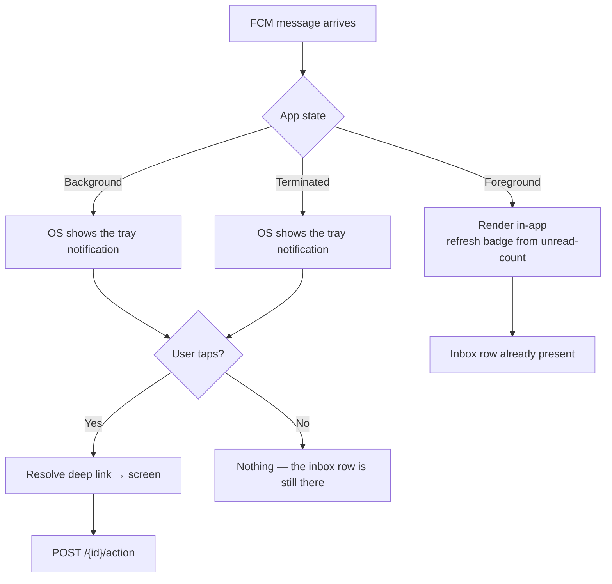
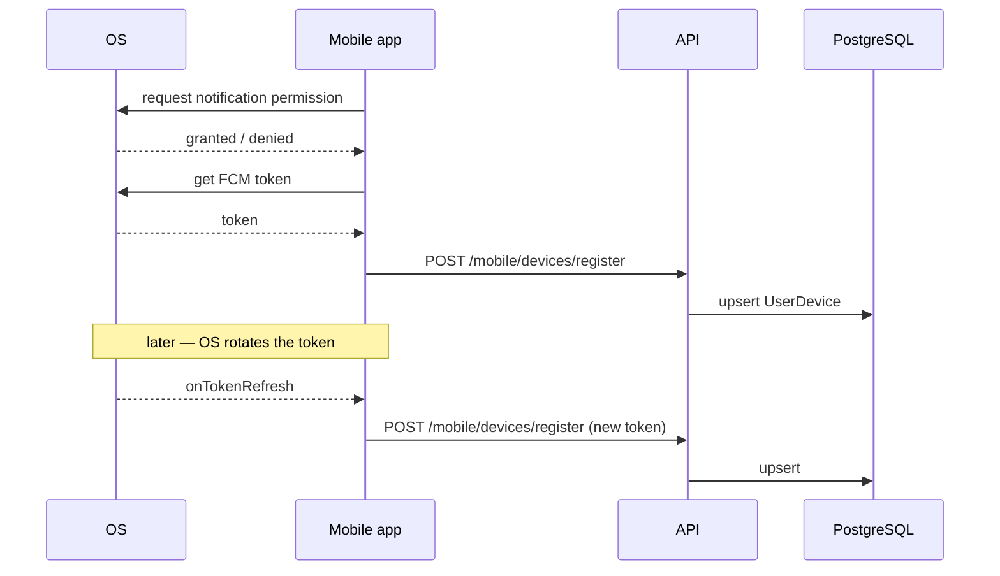

# Notification

> **Status:** Current · **Owner:** Mobile team · **Last reviewed:** 2026-10-24
> **Code:** `lib/features/notification/` (inbox, preferences, push registration) ·
> `lib/core/notifications/` (channels, deep links, local presenter, push service)

**The inbox is the notification.** Push only makes it arrive sooner. A rep who
never receives a push still sees everything in the in-app inbox after a sync.
Rules for changing this feature: [`.claude/rules/firebase.md`](../../../.claude/rules/firebase.md).

---

## Documents

**Mobile contracts** (what the app calls):

| Document | Contains |
|---|---|
| [api/mobile.md](api/mobile.md) | Inbox, badges, actions, preferences, devices. **The contract** |
| [api/devices-register.md](api/devices-register.md) | Push-token registration: the first thing that must work |

**Backend design** (copied from the API repo for reference; the backend repo
is authoritative):

| Document | Contains |
|---|---|
| [workflow.md](workflow.md) | Raise → dispatch → read → action, end to end |
| [business-rules.md](business-rules.md) | State model, preferences, multi-device rules |
| [architecture.md](architecture.md) | The server pipeline and where each piece lives |
| [data-model.md](data-model.md) | Server tables, entities, enumerations |
| [security.md](security.md) | Permissions and the device-ownership boundary |
| [api/admin.md](api/admin.md) | Broadcast, test push, delivery logs (admin, not mobile) |

**Tests:** `test/features/notification/` (inbox repository, API mapper, push
registration, push permission, sheet) and
`test/core/notifications/notification_deep_link_test.dart`.

---

## Why push is not delivery

Every notification is written to the server database as an inbox row **before**
any channel is tried. Push is the least reliable channel: a rep can deny the
permission, the OS can revoke a token, Firebase can be unreachable, the handset
can be off for a day. None of those lose an inbox row.

## Categories

`Assignment` · `Quote` · `Order` · `Finance` · `Kpi` · `Approval` · `Account` ·
`System` · `Announce` · `Security`

Wire values are upper-case (`ASSIGNMENT`); the enum name is what is stored.

## Channels

`Inbox` · `Push` · `Email` · `Sms` · `Web`

`Inbox` is always attempted and never skipped by a preference. The others are
per-user, per-category preferences, and a skipped channel is recorded as a
`Skipped` delivery rather than silently dropped — so "why didn't I get an email?"
is answerable from the delivery log.

## Two ways a notification is raised

1. **A domain event** — picked up by `NotificationRaisedDomainEventHandler` after
   commit.
2. **An admin broadcast** — `POST /api/v1/admin/notifications/broadcast`.

Both go through `NotificationService`. There is no third path that bypasses
preferences or delivery logging.

## What is shipped, and what is specified but not built

The requirement documents (`requirement/notification/` ⧉ backend repo) specify twelve
business flows (route assignment, stop changes, visit reminders, quotation status,
sales order events, KPI warnings, offline sync notices, and more). **The
infrastructure for all of them is shipped** — categories, priorities, states, deep
links, the event catalogue, delivery logging and push.

The **event producers** for most of those flows are not, because the features that
would raise them (quotations, orders, KPI) do not exist yet. What exists today is
the pipeline plus admin broadcast.

---

## Push by app state

The right-hand path is the point: **every branch that does not reach the user still
leaves an inbox row.** The client never depends on having received the push.

## Device registration and token refresh

A denied permission is not an error state for the backend: no device row, no push
deliveries, inbox unaffected.

On the device this lives in `lib/core/notifications/push/` behind a factory with
a **web no-op**: a browser registers no FCM token and the inbox still syncs
(ADR-0010).
