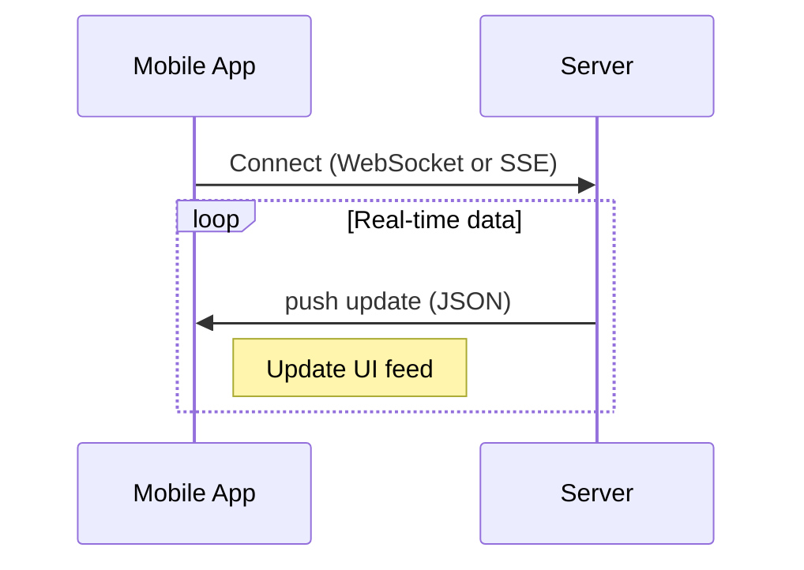
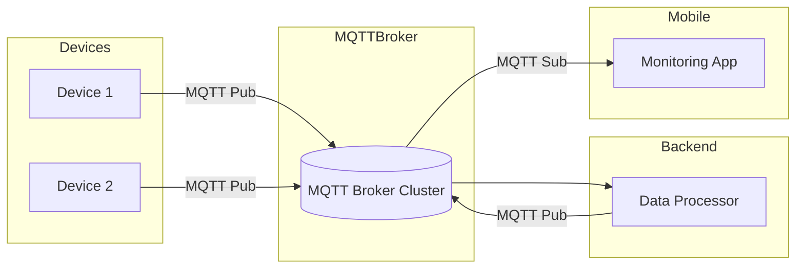

# Executive Summary

Implementing real-time updates in a mobile app involves choosing among several communication models (push, polling, streaming) and technologies (WebSocket, MQTT, SSE, HTTP/2/gRPC, push notifications, or managed services like Firebase, Pusher, Ably). Each approach has trade‐offs in latency, scalability, battery/network usage, offline behavior, consistency, security, and developer effort. For example, **WebSockets** enable low-latency bidirectional messaging (ideal for chat or live collaboration) but require persistent connections that can drain battery and must handle reconnections. **MQTT** is a lightweight publish/subscribe protocol designed for IoT and flaky networks (supports multiple QoS levels for delivery guarantees). **Server-Sent Events (SSE)** provide simple one-way HTTP streaming (good for feeds or notifications) with built-in auto-reconnect and resume support. Native **push notifications** (APNs on iOS, FCM on Android) are most battery-efficient for background updates, but have higher latency, size limits, and weaker ordering guarantees. Backend-as-a-Service platforms like **Firebase Realtime Database/Firestore**, **Pusher**, **Ably**, and **Socket.IO/SignalR** abstract many details (offering SDKs for Android, iOS, React Native, Flutter) but may impose cost or vendor lock-in. 

This report rigorously compares these options, citing official documentation and engineering sources, and provides code examples for Android, iOS, React Native, and Flutter. We evaluate each approach on latency, scalability, efficiency, offline support, security, consistency/conflicts, delivery guarantees, cost, and developer ergonomics. Tables summarize trade-offs, and recommended architectures are given for use-cases like chat, live feeds, collaborative editing, and IoT telemetry. Finally, we present an implementation checklist and mermaid diagrams (architecture/sequence) to guide a production-ready real-time mobile app. 

## Real-Time Communication Models

### Polling (Short/Long)
Traditional polling (periodic HTTP requests) is simple but resource-intensive. **Short polling** (client requests at intervals) is easy to implement (plain REST) but adds latency (update freshness depends on interval) and wastes network/battery. **Long polling** holds an HTTP request open until data arrives, then immediately re-issues the request. This emulates real-time without a true persistent connection, but still incurs HTTP overhead on each response. Polling is low-complexity (works on any HTTP stack) but scales poorly and is generally a fallback if no other options are available. It may suffice for “not truly real-time” use-cases or for legacy system compatibility, but is not recommended for demanding live updates (chat, games, etc) due to higher latency and server load.

### Server-Sent Events (SSE)
SSE (EventSource) is an HTTP/1.1 streaming protocol that keeps a connection open for one-way server-to-client updates. An SSE connection is *semi-duplex*: the client sends an initial HTTP request, then the server “pushes” newline-delimited messages in the response stream. Native support (e.g. `EventSource` in browsers) provides automatic reconnect and uses the `Last-Event-ID` header to resume missing messages. SSE is simple (low implementation complexity) and suitable for unidirectional feeds (e.g. live news feed or large-model streaming). However, SSE only works when the app is in the foreground or actively running; once the OS suspends or kills the app, the HTTP stream ends. SSE also relies on HTTP and TCP, so it incurs some overhead per message (which is usually acceptable for text-based events). Battery-wise, SSE avoids the extra framing of WebSockets but still requires the TCP connection to stay alive. (In practice, mobile apps rarely use raw SSE – they either rely on WebSockets or fall back to SSE for simple web clients.)  

### WebSockets
WebSockets provide a full-duplex TCP connection between client and server, ideal for truly bidirectional real-time communication. Once a WebSocket is established (via an HTTP handshake upgrade), the client and server can send messages asynchronously with low overhead. This enables ultra-low latency updates (tens of milliseconds) and binary or JSON payloads. WebSockets are widely supported on Android (e.g. via [OkHttp’s `newWebSocket()`](https://square.github.io/okhttp/) or other libraries) and iOS (Apple provides `URLSessionWebSocketTask` on iOS 13+, or third-party libraries like Starscream). In React Native and Flutter, WebSocket clients are also available (React Native’s JS engine supports `new WebSocket(...)`, Flutter has `web_socket_channel`). 

However, mobile WebSockets present challenges: the persistent connection consumes power, must survive network changes and sleeps, and has no built-in header for authentication. TCP idle timeouts (e.g. by carriers or NATs) require periodic “ping/pong” heartbeats to detect disconnections. Overusing heartbeats drains battery, so often a hybrid approach is used: use a WebSocket while the app is active (low-latency) but switch to OS push notifications in the background to save power. In practice, developers often wrap WebSockets in a higher-level protocol or service (e.g. Socket.IO, Pusher Channels, or Ably) that handles reconnection, buffering, channel/publish semantics, and token-based auth. For example, Ably provides an SDK with simple publish/subscribe calls that work over WebSockets under the hood:
```swift
let ably = ARTRealtime(key: "ABLY_API_KEY")
let testChannel = ably.channels.get("test")
testChannel.publish("greeting", data: "hello")

let listener = testChannel.subscribe("greeting") { message in
    print("Received: \(message.data)")
}
```
This iOS Swift code (cited from Ably’s docs) hides the raw WebSocket and gives a clean API. 

### MQTT
MQTT is a lightweight pub/sub protocol designed for constrained devices and unreliable networks. Clients connect to an MQTT **broker** over TCP (often using TLS) and subscribe to topics. When any client publishes to a topic, the broker forwards the message to all subscribers. MQTT’s header is very small, making it network/battery-efficient. Critically, MQTT defines three Quality-of-Service levels for delivery: *QoS 0* (at most once, no retry), *QoS 1* (at least once, with possible duplicates), and *QoS 2* (exactly once, via a two-phase handshake). This gives precise control over delivery guarantees. Persistent sessions and retained messages allow clients to receive missed messages upon reconnect. These features make MQTT ideal for **IoT telemetry** or any mobile scenario with spotty connectivity. For example, a background sensor reading app could publish via MQTT with QoS 1 to ensure data is not lost, even if the connection drops briefly.

Popular MQTT client libraries exist for Android (Eclipse Paho, HiveMQ), iOS (CocoaMQTT, MQTT-Client-Framework), and cross-platform (emqtt, mqtt.js via WebSockets, etc). However, browsers do not support raw MQTT, so web clients must use MQTT-over-WebSocket bridges. MQTT requires managing a broker (operational cost) but scales well for many devices and connections. Battery-wise, MQTT can be more efficient than raw WebSockets because of its small messages and optional keep-alives, but like WebSockets it still needs a persistent link (ping intervals) to detect dead connections.

### HTTP/2 Server Push and gRPC Streaming
Pure HTTP/2 server push is primarily for pushing HTTP resource hints, not general data streams to apps, so it’s rarely used directly by mobile apps for updates. Instead, **gRPC** (which uses HTTP/2 under the hood) supports *server-streaming* and *bidirectional streaming* RPCs. gRPC streams are efficient and strongly typed, but require a gRPC stack on client/server. Mobile support exists (e.g. gRPC-swift, gRPC Java/Kotlin, gRPC Dart), making it an option for apps that already use gRPC. Streaming RPCs behave much like long-lived connections: they can deliver server updates continuously. gRPC can also leverage HTTP/3 (QUIC) which adds low-latency and improved reconnection under loss, though mobile library support is still emerging.

### Native Push Notifications (APNs/FCM)
Platform push services (Apple Push Notification service and Firebase Cloud Messaging) are the mobile OS’s built-in “push” channels. Push is **highly battery-efficient** because the OS batches and handles network reconnection. However, push is not truly “real-time” – delivery latency can vary from hundreds of milliseconds to seconds, depending on network and OS conditions. Payload size is limited (few kilobytes), and iOS imposes strict rate limits and background execution limits. Push is best used to wake the app when new data is available, rather than streaming every message. In many real-time apps, a common pattern is: use WebSockets/MQTT for live updates when the app is active, and use APNs/FCM to notify the device of new data when the app is backgrounded. For example, a chat app might send an FCM data message (with high priority) when a new message arrives, so that if the app is asleep it gets woken up to fetch or display the message. The trade-off: push can incur server costs (APNs/FCM quotas, push service costs) and offers only best-effort delivery (messages might be dropped if the device is offline for long) and no built-in ordering.

## Real-Time Data Platforms & SDKs

Beyond raw protocols, many mobile developers use managed platforms or libraries that abstract real-time messaging:

- **Firebase Realtime Database / Cloud Firestore (Google).** These are cloud NoSQL databases with built-in real-time sync. Clients attach listeners to data paths (Realtime DB) or document collections (Firestore), and updates are pushed to all clients. Both handle offline caching and synchronization automatically: for example, enabling offline persistence in Realtime DB caches writes on disk. Writes made offline are queued and sent when connectivity returns, and listeners fire with local data instantly. Firestore offers similar offline support with a local cache (default 10 MB) and listener queuing. Using Firebase greatly simplifies real-time: minimal code is needed, and scaling is handled by Google. However, drawbacks include vendor lock-in, potentially high data-usage costs at scale (each listener update can count as a read/write), and less control over conflict resolution (Firestore uses “last write wins” by timestamp). Example (Android, Realtime DB with offline):
    ```kotlin
    Firebase.database.setPersistenceEnabled(true)          // enable offline cache
    val scoresRef = Firebase.database.getReference("scores")
    scoresRef.keepSynced(true)                             // keep this location synced
    scoresRef.addValueEventListener { snapshot ->
        val scores = snapshot.children.map { it.getValue(Int::class.java) }
        // update UI with latest scores
    }
    ```
- **Pusher Channels.** A hosted real-time messaging service using WebSockets (and fallbacks) with client SDKs for mobile. Clients subscribe to “channels” and receive events via REST or WebSockets. Pusher manages scaling and reconnections. It supports presence channels and encryption. Code is similar to Ably’s (obtain a client, subscribe, bind event handlers). Drawbacks include usage cost (subscription limits) and reliance on a third-party service.
- **Ably Realtime.** As seen above, Ably provides pub/sub over WebSocket (and MQTT/SSE) with rich client libraries. It handles reconnection, persistence, presence, and token auth for you. Ably explicitly supports iOS/Android/Flutter/React Native. For example, in Android one might do:
    ```java
    ARTRealtime ably = new ARTRealtime("ABLY_API_KEY");
    ARTChannel channel = ably.channels.get("test");
    channel.publish("greeting", "hello");  // publish
    channel.subscribe("greeting", new MessageListener() {
        @Override
        public void onMessage(ARTMessage message) {
            Log.d("Ably", "Received: " + message.data.toString());
        }
    });
    ```
- **Socket.IO / SignalR.** These are higher-level frameworks (socket.io for JS backends, SignalR for .NET) that provide real-time messaging APIs atop WebSockets (with fallback to polling). They add features like automatic reconnection, multiplexing, and RPC semantics. Native clients exist (e.g. Socket.IO-client-Java for Android, or using JavaScript bridge in React Native). They are performant but can be heavier (extra headers) and may require sticking to a specific server stack.
- **Custom Long-Polling/SSE Solutions.** Some apps roll their own using HTTP long polling or SSE endpoints, especially for simple notifications. Modern mobile apps tend to prefer WebSockets or push over custom polling, but the option exists for niche scenarios.

## Key Considerations and Trade-offs

Professional developers weigh these attributes when choosing a real-time solution:

- **Latency:** WebSockets, MQTT, and gRPC streams offer *sub-100ms* latency and immediate push of data. SSE is usually milliseconds to seconds (depending on server flushes). Push notifications are on the order of hundreds of ms to seconds. Polling latency equals the interval (tens of seconds if infrequent). For live chat or gaming, low latency is crucial (favor sockets or gRPC). For non-interactive feeds, higher latency (SSE/polling) might suffice.

- **Scalability:** 
  - **Socket servers** (WebSocket/MQTT) require horizontal scaling (sticky sessions or broker clustering). Known limits are tens of thousands of concurrent connections per node; solutions like Redis pub/sub or managed services (e.g. AWS IoT, Azure SignalR Service) are used to scale out. 
  - **Push services** leverage Google/Apple infrastructure (virtually unlimited at scale, but subject to provider quotas). 
  - **Firebase** scales transparently (managed by Google) but can incur high bandwidth costs if many clients listen to high-rate data. 
  - **Polling** always scales the worst (each client hits the server continuously). 
In general, pub/sub models (MQTT with broker, or cloud pub/sub) scale better than server-centric websockets for *many publishers and subscribers* (e.g. IoT with millions of devices often use MQTT or a cloud IoT hub).

- **Battery & Network Efficiency:** Persistent connections consume power. **WebSockets** require work to maintain (TCP keep-alives or ping frames) and will keep the radio on. Ably notes that “[the more heartbeats you send], the faster battery is depleted…to preserve battery life, you may want to use OS-native push notifications where possible”. **MQTT** with optimized keep-alive can be lower power (smaller packets). **Push notifications** are most efficient for idle devices (OS handles wake). Network-wise, binary protocols (WebSocket with MessagePack, MQTT) use less data than verbose JSON. Mobile platforms may throttle or kill idle connections (especially on iOS in background), so one should detect connectivity changes and re-connect quickly.

- **Offline Support & Sync:** Native push and sockets cannot deliver updates when offline; apps must handle this. Firebase’s offline mode is a best-practice example: it persists a write queue and local snapshot, and automatically syncs with the cloud on reconnect. Other strategies include using a local database (SQLite/Room, Realm, or Couchbase Lite) and syncing to the server later. Conflict resolution is important: Firestore uses last-write-wins (by server timestamp), but for collaborative editing one often uses CRDT/OT techniques to merge concurrent changes. The choice of data model (state vs event log) affects consistency: e.g. chat messages (append-only) are easy to merge, whereas shared counters or documents need merging logic.

- **Security & Authentication:** All real-time channels should use TLS (WSS, SSL). Since WebSocket frames have no headers, authentication often occurs during the opening handshake (e.g. sending a short-lived token or API key as a query parameter). Basic API keys (long-lived) are insecure on the client; instead use JWTs or OAuth tokens that expire. Many SDKs (Firebase, Ably, Pusher) integrate auth: e.g. Ably’s SDKs handle token renewal and permissions. Always validate data on the server side. If broadcasting to channels/rooms, enforce authorization (e.g. “user X may subscribe only to channels they’re in”). Rate-limit and encrypt sensitive payloads as needed.

- **Data Consistency & Conflicts:** Real-time updates often assume the server is authoritative, but when clients can update state offline, merging is needed. Many systems default to *last write wins* (e.g. Firestore), which can override others’ edits. For collaborative editing, use conflict-free data structures or explicit operational transforms. In chat or feeds, message ordering is usually monotonic (each message has a server timestamp or sequence). For reliability, ensure your protocol or service provides an ordering guarantee (TCP does order by default, MQTT preserves order per topic/QoS). If using push notifications or multiple channels, be aware that delivery can arrive out of order.

- **Delivery Guarantees & Ordering:** 
  - **WebSockets/SSE/HTTP:** run over TCP, which guarantees in-order delivery and no duplication (aside from network glitches). However, if a connection drops and is retried, some messages may need replay logic at the application level.
  - **MQTT QoS:** allows configuring delivery semantics. QoS=1 or 2 ensure delivery (possibly duplicates for QoS1). 
  - **Push Notifications:** do not guarantee ordering or delivery. FCM/APNs will drop excess messages and may deliver duplicate or outdated messages, so design messages to be idempotent or carry context (e.g. a sequence number or timestamp).
  - **Custom SSE/Long-poll:** SSE can resume from last event ID, but WebSocket-based fallback must handle lost messages via sequence numbers at app layer. Many pub/sub services (Ably/Pusher) provide message persistence or replay buffers to fill missed gaps.

- **Cost & Operational Complexity:** 
  - **Self-Hosted Solutions** (own WebSocket/MQTT servers): require provisioning servers, managing load balancers (with sticky sessions or brokers), TLS certificates, and monitoring. They can be cheap per-connection but incur devops work.
  - **Managed Services** (Firebase, Ably, Pusher): reduce ops but charge by usage (connections, messages, bandwidth). For example, Firebase charges for GB transferred and document writes; Ably/Pusher have tiered pricing per messages/GB. Cloud push (FCM/APNs) is free for basic usage, but heavy use of FCM data messages may incur Firebase Cloud Functions costs or Cloud Firestore reads.
  - Evaluate expected scale: millions of users usually favor managed Pub/Sub or push networks; hundreds-thousands may self-host.

- **Developer Ergonomics:** 
  - Firebase and commercial SDKs score high: they abstract reconnection, offer offline APIs, and have client libraries in all platforms (Android, iOS, web, Flutter, RN). Code is usually a few lines (as shown above). 
  - Raw WebSockets/MQTT require more plumbing (managing connect lifecycle, heartbeats, serialization). Testing each platform’s client can be more tedious. 
  - JavaScript-based solutions (Socket.IO, Pusher) integrate naturally with React Native (JS runtime). 
  - Native languages (Kotlin/Swift) may lack a unified syntax, but libraries like OkHttp and Starscream are mature.
  - Good documentation and community examples are key (Firebase and Pusher both have extensive guides).

- **Testing & Monitoring:** Monitor connection health (e.g. count of dropped/reconnections), message latency, and errors. Use crashlytics/logging (e.g. Firebase Crashlytics) to log WebSocket errors. Load-test servers with tools like Gatling or custom scripts. Test under poor network (simulate offline, 2G, high latency) using tools (Android’s Network Link Conditioner, iOS’s network conditioning). Instrument message rates and queue lengths. For push, monitor FCM/APNs delivery feedback (both platforms offer delivery/feedback reports for debugging).  

## Platform-Specific Implementation

Real-time features span multiple SDKs. Key examples:

- **Android (Kotlin/Java):** Native apps can use [OkHttp’s WebSocket client](https://square.github.io/okhttp/) or [Socket.IO’s Java client](https://github.com/socketio/socket.io-client-java) for raw sockets. MQTT clients (Eclipse Paho, HiveMQ Android) handle publish/subscribe. Firebase Realtime Database or Firestore have Android SDKs with listeners. Android also provides [WorkManager](https://developer.android.com/topic/libraries/architecture/workmanager) for scheduling background sync tasks. For push, one implements `FirebaseMessagingService` to receive FCM payloads. Example (Kotlin, enabling Realtime DB offline from Firebase docs):
    ```kotlin
    // Enable disk persistence (offline caching)
    Firebase.database.setPersistenceEnabled(true) 

    // Keep this reference synced
    val scoresRef = Firebase.database.getReference("scores")
    scoresRef.keepSynced(true)
    scoresRef.addValueEventListener { snapshot ->
        // Received update on "scores"
        val scores = snapshot.getValue<List<Int>>()
        updateScoresUI(scores)
    }
    ```
    [37†L478-L487][37†L528-L536] shows how enabling persistence allows local reads/writes to survive offline.

- **iOS (Swift/Objective-C):** Use `URLSessionWebSocketTask` on iOS 13+ for WebSockets, or libraries like [Starscream](https://github.com/daltoniam/Starscream). For HTTP/2 or gRPC, use NSURLSession or gRPC Swift. MQTT clients (CocoaMQTT, MQTT-Client-Framework) are available. Firebase offers the iOS SDK; Realtime Database and Firestore clients mirror the Android usage (with `observe(.value)` for realtime updates). Push is via [Apple Push Notification Service (APNs)](https://developer.apple.com/notifications/). Authentication can use OAuth tokens or Apple’s [Network.framework’s WebSocket protocol](https://developer.apple.com/documentation/networkprotocol/networkprotocolevents) (iOS 13’s NWWebSocket).
  
- **React Native (JavaScript):** RN’s JS thread supports **WebSockets** out-of-the-box using the standard `WebSocket` API:
    ```js
    const ws = new WebSocket('wss://example.com/socket');
    ws.onopen = () => { console.log('WebSocket open'); };
    ws.onmessage = (e) => { console.log('Msg from server: ' + e.data); };
    ws.onerror = (e) => { console.error(e.message); };
    ```
  Most push libraries work with React Native (e.g. `@react-native-firebase/messaging` for FCM). Many cloud services have React Native plugins (e.g. `pusher-js` works via WebSockets). Note: React Native does *not* support MQTT natively (you’d need a JS MQTT library over WebSockets). Firebase Realtime/Firestore can be used via `@react-native-firebase/database` or `@react-native-firebase/firestore`.
  
- **Flutter (Dart):** Flutter apps can use packages like [`web_socket_channel`](https://pub.dev/packages/web_socket_channel) or [`socket_io_client`](https://pub.dev/packages/socket_io_client) for WebSockets, and [`mqtt_client`](https://pub.dev/packages/mqtt_client) for MQTT. The `cloud_firestore` plugin provides real-time streams via Dart streams (`.snapshots()`). Example (Dart, WebSocket):
    ```dart
    import 'package:web_socket_channel/io.dart';

    final channel = IOWebSocketChannel.connect('wss://example.com/socket');
    channel.stream.listen((message) {
      print('Received: $message');
      // Update app state
    });
    ```
  For push, Flutter uses plugins (`firebase_messaging`) to interface with FCM/APNs. Authentication tokens (OAuth/JWT) can be obtained via `firebase_auth` or other means and sent over sockets as needed.

**Developer Ergonomics:** In all cases, use language-native APIs when possible (e.g. `URLSessionWebSocketTask` for Swift, `WebSocket` for JS, `WebSocketChannel` for Dart). For managed services, follow the official guides (e.g. Firebase docs for multi-platform). Keep concurrency issues in mind (WebSocket callbacks may not run on UI thread). Leverage high-level constructs (Combine/Flow, RxSwift/Flowable, Kotlin coroutines) to integrate streaming data into the app’s logic cleanly.

## Use-Case Architectures

Different real-time features favor different architectures. Below are common scenarios:

- **Chat / Real-time Messaging:** Use WebSockets or a pub/sub service. Each client maintains a socket connection to the server. The server broadcasts incoming messages to all participants. Ensure message ordering (TCP provides this), and handle reconnection (cache last message ID to avoid duplicates). Example architecture:

```mermaid
flowchart LR
    subgraph Mobile Clients
      A[User A (Android)]
      B[User B (iOS)]
    end
    subgraph Server
      WS[WebSocket Server]
      DB[(Chat Database)]
    end
    A -->|WebSocket| WS
    B -->|WebSocket| WS
    WS --> DB
    subgraph Push
      P[FCM/APNs]
    end
    WS -.->|Trigger push| P
    P -.-> A
    P -.-> B
```
Clients connect to WS for chat. When a message arrives, WS writes to DB and pushes to other clients. If a user is offline, WS can send a push notification via FCM/APNs to wake the app and fetch missed messages.

**Chat recommendations:** Full-duplex WebSockets (Socket.IO or MQTT with QoS1) for live chat. Store messages on server (for history and offline catches). Use push notifications to alert sleeping clients of new messages. Employ sequence numbers or timestamps to order or de-duplicate. Tools: Ably Channels or Firebase Realtime/Firestore (both have chat tutorials).  

- **Live Feed / News Updates:** Often uni-directional (server→clients). SSE or WebSockets both work, but SSE is simpler if only server push is needed. For example, a stock ticker or news feed can use an SSE endpoint and update the UI on each event. If using WebSockets, the client need only listen and ignore the “send” capability. Example timeline:



If the feed can be missed (e.g. app asleep), consider caching the latest feed item server-side so the client can request it upon reconnection. Firebase Realtime DB works well here with `.keepSynced(true)` to always have the latest data.

- **Collaborative Editing / Multi-User Data:** Complex cases like live document editing require conflict resolution. Common solutions use operational transforms (OT) or Conflict-Free Replicated Data Types (CRDTs). For mobile, one can use a service like Firebase Firestore (which merges simple edits via last-write-wins) or implement a CRDT library (e.g. [Y.js](https://github.com/yjs/yjs) over WebSockets). The architecture typically has a central sync server (or cloud) and clients exchanging change sets. Example: Google Docs uses WebSocket (via its own protocol) to broadcast operations and a server to merge. For mobile, a simpler pattern is Firestore: clients write updates to documents, and Firestore syncs automatically. Even with Firestore, complex conflicts should be resolved in code (merge fields or alert user).

- **IoT Telemetry / Sensors:** Use MQTT or specialized IoT services (AWS IoT, Azure IoT Hub, etc). The mobile app can act as a **subscriber** on MQTT topics to receive telemetry updates, or as a **publisher** if sending sensor data. Typical architecture:


Sensors publish to broker (e.g. AWS IoT Core). A backend processes data (alerts, storage) and can publish commands/updates. The mobile app subscribes to relevant topics (via an MQTT client) or pulls data from a database. MQTT’s low-bandwidth design suits telemetry. Ensure use of QoS1/2 for critical data, and TLS+JWT for device auth. The mobile app may not need a persistent connection at all times; it could use FCM to trigger a data fetch if battery is a concern.

## Comparison of Approaches

| Approach              | Bidirectional? | Protocol Type          | Latency         | Battery Impact        | Offline Support               | Delivery Guarantee      | Example Use-Cases                    |
|-----------------------|----------------|------------------------|-----------------|-----------------------|-------------------------------|-------------------------|--------------------------------------|
| **WebSocket (raw)**   | Yes            | TCP long-lived         | ≈10–100ms       | High (persistent conn) | Must implement local cache/sync. | TCP guarantees order, no dup (except on reconnect) | Chat, games, collaboration |
| **MQTT**              | Yes (pub/sub)  | TCP long + broker      | ≈10–100ms       | Medium (optimized keep-alive) | Session persistence, offline queued via broker | QoS 0/1/2 selectable (exactly-once optional) | IoT telemetry, mobile commands |
| **Server-Sent Events (SSE)** | No (one-way) | HTTP streaming (long) | ~100ms–1s       | Medium (persistent HTTP) | Partial: HTTP reconnect with `Last-Event-ID` | TCP (in-order). Auto-reconnect and resume built-in | News feeds, notifications, stream outputs |
| **gRPC Streaming**    | (Yes, if bidi) | HTTP/2 bidirectional   | ≈10–100ms       | Medium (depends on HTTP/2) | Use client-side cache, manual sync | TCP (in-order) | Complex RPC with real-time needs (apps, microservices) |
| **Push (APNs/FCM)**   | Limited (no)   | Platform push (UDP-like) | 100ms–several s | Low (OS-managed) | Can wake app for sync; limited persistence (APNs holds 1 last message) | No ordering (best-effort, may drop) | Background alerts, notifications |
| **Polling (short)**   | No             | HTTP request-response  | Dependent on interval | Very high (frequent requests) | Works offline (reads stale or fails); no sync | None (only latest request) | Legacy support, fallback |
| **Long Polling**      | Pseudo         | HTTP (hold-request)    | ≈100ms–1s       | High (reconnect after each poll) | Same as short poll | None | Degraded “push” if websockets unavailable |
| **Firebase Realtime** | Yes (via listen)| Proprietary (sync)    | ≈100ms (cloud)  | Low (efficient sync, offline cache) | Built-in offline persistence | Eventual (last-write-wins) | App state sync, simple chat (small scale) |
| **Cloud Firestore**   | Yes (via listen)| Proprietary (sync)    | ≈100ms         | Medium (uses websockets/Firebase protocol) | Built-in offline (10MB cache) | Eventual consistency | Complex sync, mobile apps with user data |
| **Pusher/Ably**       | Yes (via lib)  | Pub/Sub (WebSocket/MQTT/SSE) | ≈50ms         | Medium (managed reconnection) | Some offer message persistence (e.g. Ably) | Configurable (Ably offers ACKs/retries) | Chat, live dashboards (SaaS) |
| **Socket.IO/SignalR** | Yes            | WebSocket + fallback   | ~50ms           | Medium (auto-reconnect) | Requires own caching | Over WebSocket (TCP) + app-level ACKs | Web/Mobile real-time features (with Node/.NET) |

*Table: Comparison of common real-time approaches. Latency is typical; actual delay depends on network. Battery impact is relative.* 

## Recommended Architectures by Use-Case

- **Chat (two-way messaging):** Best with WebSockets or an SDK like Socket.IO/Ably. Use a persistent connection when the app is foreground. Backend should broadcast to channel and store messages. Add push notifications (FCM/APNs) for offline alerts. *Checklist:* TCP encryption, authentication token, WebSocket reconnection, message queueing, push fallback.

- **Live Feed / Notifications:** If only server→client updates, SSE or WebSockets are suitable. For simple apps, Firebase Realtime DB/Firestore can publish changes to all listeners with little code. For critical updates (e.g. emergency alerts), combine feed with push notifications. *Checklist:* Use HTTP streaming or Firebase listeners, handle token refresh, ensure reconnection, cache last update for offline.

- **Collaborative Editing:** Use a structured sync (e.g. Firestore or a custom OT/CRDT server). All clients listen to a data document (over Firestore or a WebSocket room). Merge conflicts via CRDT library or server logic. *Checklist:* Decide on data model, use timestamps or vector clocks, test concurrent edits.

- **IoT Telemetry / Remote Control:** MQTT is ideal. Mobile app subscribes to device topics (e.g. `device/+/status`). It can also publish commands. Use QoS 1 or 2 for reliability. TLS+JWT credentials. If using cloud IoT (AWS, GCP), follow their client libraries. *Checklist:* MQTT client setup, topic auth, clean session vs persistent, keep-alive interval tuning, offline queuing.

## Implementation Checklist

1. **Choose Protocol/Service:** Based on use-case (e.g. WebSocket vs MQTT vs SSE vs Push). Consider cross-platform support (Flutter has plugins for MQTT and websockets, React Native has built-in WebSocket).
2. **Authentication & Security:** Implement TLS/WSS. Use short-lived tokens (OAuth/JWT) rather than static API keys. Validate permissions on server-side.
3. **Connection Management:** Establish and monitor the real-time connection on app start. Detect network changes (use `ConnectivityManager`, `NetworkCallback`, etc) to reconnect or pause updates.
4. **Heartbeat & Keep-Alives:** If using raw sockets/MQTT, configure ping intervals. Avoid too-frequent heartbeats to save battery. Rely on OS pushes to wake from deep sleep instead of idle sockets.
5. **Offline Behavior:** Integrate local persistence (SQLite/Room, Realm, or Firebase offline) so data remains available offline. Queue any outbound writes and sync on reconnect.
6. **Message Handling:** Implement idempotency or sequence checks if needed (e.g. ignore duplicate MQTT messages). Ensure UI updates run on main thread.
7. **Fallbacks:** Plan fallback for connectivity loss: e.g. retry with exponential backoff. Provide user feedback (e.g. “Reconnecting…”).
8. **Testing:** Simulate poor networks and app background/foreground transitions. Test on real devices (Android Doze, iOS background limits).
9. **Monitoring:** Log connection stats (uptime, errors) and message rates. Use analytics/APM to track latency and dropped messages.
10. **Scaling & Cost:** If self-hosting, set up load-balanced servers or brokers (sticky sessions for WebSockets, clustered MQTT). If using a service, configure quotas/alerts to avoid surprise charges.
11. **Security Review:** Penetration-test the real-time endpoints (prevent injection in payloads, verify TLS certificates).
12. **Release Readiness:** Ensure user privacy compliance (GDPR, etc) if pushing personal data. Have analytics for message success rates. 

By following these guidelines and leveraging the right technology stack for the job, mobile developers can build robust, efficient real-time update features. 

**References:** Established engineering blogs and official docs inform the above analysis, which collectively cover protocols, platforms, and best practices for production-ready mobile real-time communication.